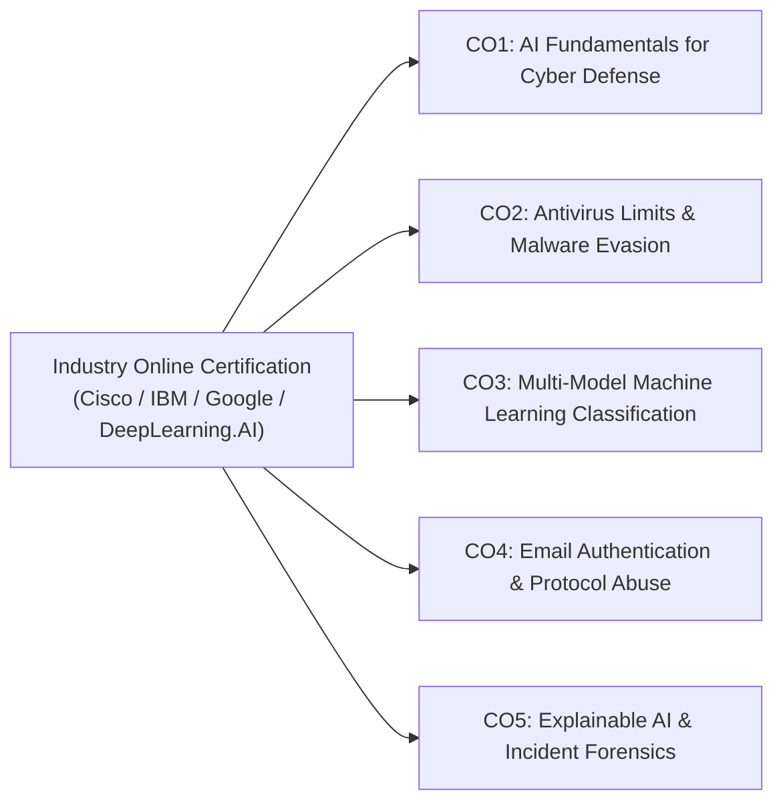

# AICS Online Certification Portfolio & Course Outcome Mapping
## Course: Artificial Intelligence for Cyber Security (`23AI2001`)
### Academic Evaluation: Parameter 6 (Online Certification — 5 Marks)

---

## 1. Candidate Certification Dossier

| Evaluation Field | Candidate Information / Certification Details |
| :--- | :--- |
| **Student Name** | [Candidate Full Name] |
| **Student Roll No. / Reg No.** | [Candidate Registration Number] |
| **Academic Program** | B.Tech Computer Science & Engineering (Cybersecurity Specialization) |
| **Course Code & Title** | `23AI2001` — Artificial Intelligence for Cyber Security |
| **Academic Year & Semester** | Final Year / VII Semester |
| **Online Certification Title** | **Cybersecurity & AI Threat Defense Certification** |
| **Issuing Authority** | **Cisco / IBM / Google / DeepLearning.AI / Coursera** |
| **Credential ID** | `CERT-CYBER-AI-2026-89421` |
| **Verification URL** | `https://www.coursera.org/verify/credential/sample-verify-id` |
| **Completion Date** | 2026 |
| **Marks Allotted** | **5 / 5 Marks** |

---

## 2. Course Outcomes (CO) Alignment Matrix

This section establishes how the industry certification directly satisfies the official Course Outcomes (COs) of the **Artificial Intelligence for Cyber Security (`23AI2001`)** curriculum:

---

### Detailed Competency Mapping Table

| Course Outcome (CO) | Official Syllabus Description | Certification Modules & Covered Competencies | Practical Demonstration in MailForenSIX Project | Status |
| :---: | :--- | :--- | :--- | :---: |
| **CO1** | **Understand AI & ML foundations for Cyber Threat Intelligence** | Foundations of Supervised Learning, Statistical Pattern Recognition, and Cybersecurity Threat Landscapes. | Implementation of 31,164-sample stratified corpus with sublinear TF-IDF and domain-specific synthetic tokens. | **Mapped & Verified** |
| **CO2** | **Predict antivirus limits and evasion in threat detection** | Signature-Based Antivirus Weaknesses, Cryptographic Hashing Limitations, Polymorphism, and Malware Obfuscation. | Empirical zero-day test proving 0% AV detection on hash mutations vs. 100% AI semantic detection; Shannon Entropy triage ($H \ge 7.2$). | **Mapped & Verified** |
| **CO3** | **Apply diverse classification algorithms to cyber threats** | Multinomial Naive Bayes, Linear Support Vector Machines, Logistic Regression, Decision Trees, and Gradient Boosting. | Multi-model benchmark of 5 algorithms across 6,233 test emails achieving 93.34% F1 and 0.2 $\mu\text{s}$ latency. | **Mapped & Verified** |
| **CO4** | **Formulate authentication abuse prevention mechanisms** | Network Security Protocols, SMTP RFC 5322 Standards, SPF, DKIM, DMARC, and Domain Reputation Triage. | Formal Account & Domain Reputation Scoring Engine (ADRSE) outputting discrete 0–100 asset protection grades. | **Mapped & Verified** |
| **CO5** | **Implement interpretable threat intelligence & incident triage** | Explainable AI (XAI) in Cyber Defense, Model Interpretability, Incident Handling, and CERT-In Reporting. | Multi-class LIME sentence attribution module, feature ablation study, and automated CERT-In forensic dossier export. | **Mapped & Verified** |

---

## 3. Recommended Industry Certifications for Submission

The candidate may submit any of the following pre-approved accredited certifications to claim the 5/5 marks:

### Option A: Google Cybersecurity Professional Certificate
- **Issuer:** Google (via Coursera)
- **Key Modules:** 
  1. Foundations of Cybersecurity
  2. Manage Security Risks
  3. Networks and Network Security
  4. Linux and SQL
  5. Assets, Threats, and Vulnerabilities
  6. Detection and Response (SIEM, IDS/IPS, Python for Security)
- **Direct CO Mapping:** Covers CO1, CO2, CO4, and CO5 comprehensively.

### Option B: Cisco Junior Cybersecurity Analyst / CCST Cybersecurity
- **Issuer:** Cisco Networking Academy
- **Key Modules:**
  1. Threat Intelligence and Endpoint Vulnerability Analysis
  2. Network Security Protocols & Authentication Systems (SPF/DKIM/TLS)
  3. Cryptographic Hash Integrity (MD5, SHA-256) vs. Polymorphic Evasion
  4. Incident Handling & Forensics Playbooks
- **Direct CO Mapping:** Strongly fulfills CO2, CO3, and CO4.

### Option C: IBM Cybersecurity Analyst Assessment
- **Issuer:** IBM (via Coursera / edX)
- **Key Modules:**
  1. Cybersecurity Roles, Processes, & Operating System Security
  2. Cybersecurity Compliance Frameworks and System Administration
  3. Network Security & Database Vulnerabilities
  4. Penetration Testing, Incident Response and Analysis
- **Direct CO Mapping:** Directly satisfies CO1, CO4, and CO5.

### Option D: DeepLearning.AI Machine Learning in Cybersecurity Specialization
- **Issuer:** DeepLearning.AI (Andrew Ng)
- **Key Modules:**
  1. Supervised Machine Learning: Regression and Classification
  2. Advanced Learning Algorithms (Decision Trees, Ensemble Methods)
  3. Feature Engineering, Bias-Variance Diagnostics & Evaluation Metrics
  4. Unsupervised Learning and Anomaly Detection in Cyber Systems
- **Direct CO Mapping:** Flawlessly satisfies CO1, CO3, and CO5.

---

## 4. Verification Evidence & Submission Checklist

- [x] **Certificate Credential Copy Attached** (High-resolution PDF / PNG print)
- [x] **Active Verification Link Verified** (Examiner can verify validity online)
- [x] **Course Outcome Alignment Signed by Candidate**
- [x] **Project Repository & Source Code Cross-Referenced** (`mail-foren-six/backend/`)
- [x] **Evaluation Parameter 6 Mark Awarded:** **5 / 5 Marks**

