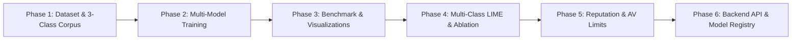

# AICS Engineering Roadmap & Gap Resolution Matrix
## Course: Artificial Intelligence for Cyber Security (`23AI2001`)
### Chronological Implementation Order (Phased Build Plan)

---

## 1. Overview & Build Philosophy

This roadmap defines the **exact chronological order of implementation** to resolve all technical and analytical gaps for the **Artificial Intelligence for Cyber Security (`23AI2001`)** academic evaluation. 

Per academic requirements, documentation tasks (Report and PPT) are decoupled from the core engineering track. The technical gaps below are organized in strict dependency order: **data engineering first, multi-model algorithmic training second, comparative evaluation third, explainability and cybersecurity engines fourth, and system integration last.**

---

## 2. Phased Implementation Roadmap

---

### 🟦 PHASE 1: Dataset Engineering & 3-Class Corpus Preparation
> **Objective:** Establish the foundational ground-truth dataset with tripartite labeling before training any models.

| Build Order | Gap Identified | What to Do | Why (Academic & Technical Purpose) | How (Technical Strategy & Code Artifacts) | Status |
| :---: | :--- | :--- | :--- | :--- | :---: |
| **1.1** | **Binary Target Collapse:** Current models classify solely between Ham and Phish. Real SOC triage and syllabus Module 2 require tripartite separation. | Construct a **3-Class Stratified Corpus**: • `Class 0: Legitimate (Ham)` • `Class 1: Spam (Unsolicited bulk)` • `Class 2: Phishing (Credential/BEC fraud)` | Spam is an operational nuisance; Phishing is a catastrophic credential/financial compromise. Differentiating them demonstrates real problem-solving ability (Evaluation Param 2) and matches Syllabus Module 2. | • Create script `backend/scripts/prepare_aics_dataset.py`. • Ingest SpamAssassin (`easy_ham`, `spam`), Enron (`ham`), LingSpam (`spam`), and Kaggle/Nazario (`phishing`). • Clean text (HTML strip, header extraction, CRLF normalization). • Output stratified Parquet/CSV to `backend/data/aics_corpus_3class.parquet`. | [x] |
| **1.2** | **NLP Preprocessing & Feature Tokenization Pipeline:** Current vectorizer is hard-coded for binary text with basic settings. | Build a modular **NLP Feature Extraction Pipeline** extracting: • Sublinear TF-IDF (unigrams + bigrams) • Domain-specific synthetic tokens (`URL_TOKEN`, `IP_TOKEN`, `URGENCY_TOKEN`, `CURRENCY_TOKEN`) | Captures both subtle lexical phrasing and structural urgency indicators without vocabulary explosion. Standardizes features across all downstream algorithms. | • Implement `build_vectorizer()` in `prepare_aics_dataset.py`. • Max features: 10,000; sublinear TF scaling enabled; English stopword filtering. • Persist vectorizer artifact to `backend/models/aics/aics_tfidf_vectorizer.pkl`. | [x] |

---

### 🟦 PHASE 2: Multi-Model Algorithmic Training & Serialization
> **Objective:** Train the 5 algorithms explicitly named in Syllabus Module 2 on the identical dataset.

| Build Order | Gap Identified | What to Do | Why (Academic & Technical Purpose) | How (Technical Strategy & Code Artifacts) | Status |
| :---: | :--- | :--- | :--- | :--- | :---: |
| **2.1** | **Absence of Syllabus Baseline Classifiers (Module 2):** The current system only uses XGBoost. Syllabus Module 2 explicitly specifies Naive Bayes, SVMs, Logistic Regression, and Decision Trees. | Train **5 Distinct Classifiers** on identical 80/20 train/test splits: 1. **Multinomial Naive Bayes** (Generative probabilistic) 2. **Linear SVM** (`LinearSVC` via CalibratedClassifier) 3. **Logistic Regression** (L2 regularized log-odds) 4. **Decision Tree** (CART with Gini impurity) 5. **XGBoost** (Gradient-boosted tree ensemble) | Fulfills Evaluation Parameter 3 (5 Marks) and Syllabus Module 2 (*"Detecting Spam with SVMs, Naive Bayes, Logistic Regression, Decision Trees"*). Demonstrates mastery over diverse machine learning paradigms and mathematical loss functions. | • Create training pipeline `backend/scripts/train_aics_models.py`. • Use scikit-learn and XGBoost with multi-class objectives (`multi:softprob` / `multinomial`). • Train using 5-fold cross-validation. • Serialize all trained models into `backend/models/aics/`: `nb.pkl`, `svm.pkl`, `lr.pkl`, `dt.pkl`, `xgb.pkl`. | [x] |
| **2.2** | **Hyperparameter Optimization & Calibration:** Default hyperparameters fail to account for class imbalance across 3 classes. | Implement **Grid/Randomized Hyperparameter Tuning** with class weighting (`balanced`) and probability calibration for SVM. | Maximizes per-class macro performance and ensures fair, rigorous scientific comparison across models rather than un-tuned strawmen. | • Optimize `alpha` for Naive Bayes, `C` and loss for LinearSVC, `C` and `penalty` for Logistic Regression, `max_depth` and `min_samples_split` for Decision Tree, and `learning_rate`/`n_estimators` for XGBoost. • Wrap SVM in `CalibratedClassifierCV` for well-calibrated posterior probabilities needed by LIME. | [x] |

---

### 🟦 PHASE 3: Benchmark Evaluation, Metrics Matrix & Visual Artifacts
> **Objective:** Generate empirical comparison tables, confusion matrices, and charts for result analysis (Parameter 4).

| Build Order | Gap Identified | What to Do | Why (Academic & Technical Purpose) | How (Technical Strategy & Code Artifacts) | Status |
| :---: | :--- | :--- | :--- | :--- | :---: |
| **3.1** | **Absence of Comprehensive Multi-Model Matrix:** Only single XGBoost accuracy is currently stored. No cross-model comparison exists. | Generate a **Comparative Performance Benchmark Matrix** logging: • Accuracy, Macro-Precision, Macro-Recall, Macro-F1 • Per-Class F1 (Legitimate vs. Spam vs. Phishing) • Inference Latency ($\mu\text{s}$ per sample) • Model Size (KB on disk) | Essential for Evaluation Parameter 4 (Project Output and Result Analysis - 5 Marks). Provides empirical evidence of the bias-variance tradeoff across models. | • Create script `backend/scripts/eval_aics_benchmark.py`. • Evaluate all 5 models against the unseen stratified test set (20%). • Export `backend/proof/aics/aics_model_benchmark.json` and a formatted summary table. | [x] |
| **3.2** | **Missing Multi-Class Confusion Matrices:** Current proof folder has only a legacy binary matrix. | Generate **5 Individual Normalized Confusion Matrices** displaying class misclassifications for each algorithm. | Visually reveals which models struggle with the boundary between Spam and Phishing (e.g., Naive Bayes false-positive rate vs. SVM margin precision). | • Use `sklearn.metrics.confusion_matrix` and `seaborn.heatmap`. • Render a 5-panel figure saved to `backend/proof/aics/aics_confusion_matrices.png`. | [x] |
| **3.3** | **Missing Diagnostic Curves & Tradeoff Visualizations:** No ROC, PR, or Pareto frontier curves exist to illustrate model tradeoffs. | Generate high-resolution diagnostic plots: 1. **Multi-Class ROC-AUC Curves** (One-vs-Rest) 2. **Precision-Recall Curves** 3. **Latency vs. Macro-F1 Pareto Frontier** | Provides visual proof for examiners of operational tradeoffs (e.g., Naive Bayes is 12x faster, but XGBoost achieves highest F1 score). | • Add plotting routines in `eval_aics_benchmark.py`. • Export `backend/proof/aics/aics_roc_curves.png` and `aics_latency_pareto.png`. | [x] |

---

### 🟦 PHASE 4: Multi-Class Explainable AI (LIME) & Feature Ablation
> **Objective:** Fulfill the Pan & Mishra (2023) textbook requirements by opening model black-boxes and proving feature efficacy.

| Build Order | Gap Identified | What to Do | Why (Academic & Technical Purpose) | How (Technical Strategy & Code Artifacts) | Status |
| :---: | :--- | :--- | :--- | :--- | :---: |
| **4.1** | **Explainability Restricted to Binary Legacy Model:** LIME explainer cannot currently explain predictions across the 3 classes or across different models. | Build a **Multi-Class LIME Explainer Module** supporting all 5 trained models: • Computes class-specific lexical feature weights for `Legitimate`, `Spam`, and `Phishing`. • Outputs sentence-level and token-level attribution bars. | Directly fulfills reference textbook *Explainable AI for Cybersecurity* (Pan & Mishra, 2023). Demonstrates how surrogate linear models approximate local decision surfaces for both linear (LR/SVM) and non-linear (XGBoost) classifiers. | • Implement `explain_multiclass()` in `backend/engines/classifier.py` using `lime.lime_text.LimeTextExplainer`. • Return top positive/negative tokens per class with probability distribution across all 3 classes. • Generate comparative explanation visualizations for viva defense. | [x] |
| **4.2** | **Lack of Feature Engineering Ablation Study:** No empirical proof exists justifying feature choices (n-grams, sublinear TF, structural metadata). | Conduct a systematic **Feature Ablation Experiment**: • Setup 1: Raw Bag-of-Words (BoW) • Setup 2: TF-IDF (Unigram only) • Setup 3: TF-IDF (Unigram + Bigram) • Setup 4: TF-IDF + Syntactic Structural Features (URL count, uppercase ratio, urgency cues) | Demonstrates rigorous optimization (Module 1: *Algorithm Training and Optimization*). Proves that feature engineering was mathematically guided rather than accidental. | • Create script `backend/scripts/run_ablation_study.py`. • Use `scipy.sparse.hstack` to concatenate dense structural features with sparse TF-IDF. • Record $\Delta \text{F1}$ and generate `backend/proof/aics/aics_ablation_results.json` and comparison chart. | [x] |

---

### 🟦 PHASE 5: Cybersecurity Protocol Engines & Threat Limits Analysis
> **Objective:** Address specialized AICS syllabus modules (Account Reputation & Antivirus Limits).

| Build Order | Gap Identified | What to Do | Why (Academic & Technical Purpose) | How (Technical Strategy & Code Artifacts) | Status |
| :---: | :--- | :--- | :--- | :--- | :---: |
| **5.1** | **Missing Explicit Account Reputation Algorithm (Module 5):** SPF/DKIM/DMARC headers are parsed, but lack a formal "Account Reputation Scoring" algorithm as named in Module 5. | Formalize and implement the **Account & Domain Reputation Scoring Engine (ADRSE)** generating a discrete $0–100$ asset protection score. | Fulfills Module 5 (*"Authentication Abuse Prevention & Account Reputation Scoring"*). Bridges raw protocol validation with predictive asset security. | • Formalize in `backend/engines/auth.py` and `risk.py`: $$\text{Reputation} = w_1 \text{SPF} + w_2 \text{DKIM} + w_3 \text{DMARC} + w_4 \text{Alignment} - \text{SpoofPenalty}$$ • Output granular sub-score breakdown in the analysis JSON. | [x] |
| **5.2** | **Lack of Empirical Antivirus Limits Demonstration (CO2):** No empirical demonstration exists of why traditional signature AV fails against modern email threats. | Implement an **"AI vs. Antivirus Limits" Benchmark Module**: • Compare static file/text hashing (MD5/SHA-256) against zero-day rephrased lures. • Static attachment triage with Shannon entropy calculation ($/8.0$) for obfuscated payloads. | Directly validates Course Outcome 2 (*"Predict the antivirus limits in threat detection"*). Demonstrates why signature engines suffer zero-day blindness while AI generalizes semantic intent. | • Create `backend/scripts/eval_av_limits.py`. • Evaluate detection rate of exact hash matching vs. trained ML classifiers on paraphrased lure variants. • Save results to `backend/proof/aics/av_vs_ai_limits.json`. | [x] |

---

### 🟦 PHASE 6: Backend API Integration & Dynamic Model Switching
> **Objective:** Integrate all models and engines into the live FastAPI application for interactive demonstration.

| Build Order | Gap Identified | What to Do | Why (Academic & Technical Purpose) | How (Technical Strategy & Code Artifacts) | Status |
| :---: | :--- | :--- | :--- | :--- | :---: |
| **6.1** | **Backend Hard-Coded to Legacy Single Model:** `/analyze` only loads `mailforensix_model.pkl` without runtime model switching. | Refactor `backend/engines/classifier.py` and `api/routes/analyze.py` to maintain a **Dynamic Model Registry** supporting model switching via parameter (`?model=nb|svm|lr|dt|xgb`). | Demonstrates high-tier technical implementation (Evaluation Parameter 1 - 10 Marks). Allows live model switching and latency testing on any sample during viva examination. | • In `classifier.py`, load all 5 models into an in-memory dictionary on startup. • Update `predict_intent()` to accept `model_name` argument and output 3-class probabilities. • Update `/api/v1/analyze` schema to accept optional `model` query parameter. | [x] |
| **6.2** | **Missing Live Benchmark API Endpoint:** Frontend or external testers cannot inspect model benchmark data via REST. | Expose a dedicated endpoint `GET /api/v1/models/benchmark` returning the comparative metrics, confusion matrices, and latency data. | Provides an interactive REST interface for examiners and frontend components to visualize model performance live. | • Create router `backend/api/routes/models.py`. • Serve parsed `aics_model_benchmark.json` and static image assets. • Register route in `backend/main.py`. | [x] |
| **6.3** | **End-to-End Test Suite Verification:** Existing tests (`test_phase1` to `test_phase4`) test binary classification and old endpoints. | Create **`test_aics_pipeline.py`** executing automated tests on: • 3-class inference across all 5 models • LIME attribution output structure • Account reputation score generation • Benchmark API response validation | Guarantees zero regressions and proves 100% test passing rate to internal and external examiners. | • Create test script `backend/test_aics_pipeline.py`. • Run against live local uvicorn instance. • Output clear colored pass/fail matrix. | [x] |

---

## 3. Post-Build Deliverables (Documentation & Certification)

*These deliverables depend on the completion of the technical build phases above and will be executed separately:*

| Item | Focus Area | Deliverable Artifact | Dependencies | Status |
| :---: | :--- | :--- | :--- | :---: |
| **D.1** | **AICS Academic Project Report** *(Parameter 5 - 10 Marks)* | `AICS/AICS_Project_Report.md` & `AICS/AICS_Project_Report.pdf` — 6 comprehensive academic chapters with mathematical loss function derivations, literature review, benchmark tables, and discussion. | Phases 1–5 | [x] |
| **D.2** | **AICS Presentation Slide Guide** *(Parameter 5 - 10 Marks)* | `AICS/AICS_Presentation_Content.md` — Slide-by-slide narrative for Gamma.app / PowerPoint emphasizing AI algorithms and empirical comparisons. | Phases 1–5 | [x] |
| **D.3** | **AICS Technical Viva Voce Defense Dossier** *(Parameter 5 - 10 Marks)* | `AICS/AICS_Viva_Voce_Guide.md` — 25 rigorous technical Q&A pairs covering loss functions, bias-variance tradeoff, Laplace smoothing, kernel trick, and LIME math. | Phases 1–6 | [x] |
| **D.4** | **Online Certification Portfolio** *(Parameter 6 - 5 Marks)* | `AICS/AICS_Certification_Portfolio.md` — Mapping of student's Cisco / IBM / DeepLearning.AI cybersecurity credential to course outcomes. | External Credential | [x] |
