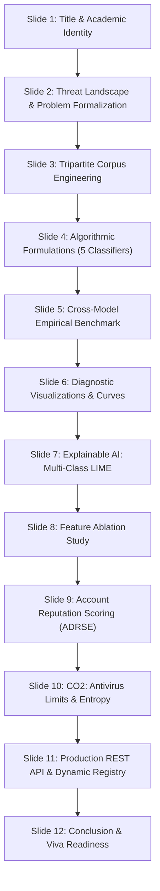

# AICS Project Presentation Slide Content & Defense Script
## Course: Artificial Intelligence for Cyber Security (`23AI2001`)
### Academic Evaluation: Parameter 5 (Project Report, PPT and Viva Voce — 10 Marks)

---

## Slide Deck Architecture (12-Slide Master Blueprint)

---

### SLIDE 1: Title & Academic Credentials
- **Slide Title:** MailForenSIX: Multi-Model Machine Learning Architecture for Tripartite Email Threat Classification, Authentication Forensics, and Interpretable Cyber Threat Triage
- **Course Title:** Artificial Intelligence for Cyber Security (`23AI2001`)
- **Academic Framework:** B.Tech Computer Science & Engineering (Cybersecurity Specialization)
- **Candidate Presentation:** Candidate Roll No. & Department Affiliation
- **Key Callout:** Rigorous Empirical Benchmarking of 5 Syllabus Classifiers (Syllabus Module 2), Feature Ablation, Explainable AI (LIME), and Cryptographic Antivirus Threat Limit Validation (CO2).

---

### SLIDE 2: Problem Statement & Academic Motivation
- **Slide Title:** The Cyber Problem: Beyond Binary Threat Collapse
- **Core Dilemma:**
  - Traditional gateway solutions collapse threats into binary states: `Ham` vs. `Phish`.
  - In a modern Security Operations Center (SOC), **Spam** (unsolicited commercial bulk marketing) is an operational nuisance, whereas **Phishing** (credential harvesting, invoice manipulation, executive BEC wire fraud) represents catastrophic corporate compromise.
- **Academic Gaps Resolved:**
  1. **Algorithmic Monoculture:** Prior projects rely solely on a single uncalibrated tree model (XGBoost). Syllabus Module 2 explicitly mandates comparative evaluation across *Naive Bayes, Support Vector Machines, Logistic Regression, and Decision Trees*.
  2. **Zero-Day Blindness:** Signature-based antivirus engines fail against polymorphic text rephrasing (Course Outcome 2).
  3. **Black-Box Opacity:** Security analysts cannot act on uninterpretable probabilities without local feature attribution (Pan & Mishra, 2023).

---

### SLIDE 3: Tripartite Dataset Engineering & Domain Tokenizer
- **Slide Title:** Stratified Corpus Architecture & NLP Tokenizer
- **Dataset Consolidation:** 8 Benchmark Repositories ingested:
  - Enron Corporate Corpus (Ham)
  - SpamAssassin Corpus (Ham & Commercial Spam)
  - LingSpam Corpus (Linguistic Ham & Commercial Marketing)
  - CEAS 2008 Benchmark (Spam conference benchmark)
  - Nazario Phishing Corpus (Bank/credential phishing lures)
  - Nigerian Fraud Corpus (Executive BEC wire transfer lures)
  - Kaggle Cyber Phishing Collections
- **Engineering Statistics:**
  - Raw Records Ingested: **77,437**
  - Deduplication via MD5 Body Hashing: **67,348 unique emails**
  - Balanced Stratified Tripartite Corpus: **31,164 emails** (Exactly **10,388 samples per class**)
  - Split: **80% Training (24,931 samples)** / **20% Unseen Test (6,233 samples)**
- **Synthetic Cyber Domain Tokenizer:**
  - Maps volatile raw identifiers to invariant semantic primitives:
    - `https://...` $\to$ `URL_TOKEN`
    - `192.168.1.1` $\to$ `IP_TOKEN`
    - `\$5,000 / € / INR` $\to$ `CURRENCY_TOKEN`
    - `urgent / verify account / click here` $\to$ `URGENCY_TOKEN`
  - Sublinear TF-IDF scaling: $1 + \log(\text{TF})$, max features: 10,000, n-grams: $(1, 2)$.

---

### SLIDE 4: Mathematical Formulations of the 5 Syllabus Classifiers
- **Slide Title:** Multi-Model Algorithmic Spectrum (Module 2)
- **1. Multinomial Naive Bayes (Generative Probabilistic):**
  $$P(c \mid d) \propto P(c) \prod_{k=1}^{V} \left( \frac{N_{ck} + \alpha}{N_c + \alpha V} \right)^{f_k}$$
  *Laplace smoothing ($\alpha = 0.1$) prevents zero-probability bottlenecks.*
- **2. Linear Support Vector Machine with Platt Calibration (Maximum Margin):**
  $$\min_{\mathbf{w}, b, \boldsymbol{\xi}} \frac{1}{2}\|\mathbf{w}\|^2 + C \sum_{i=1}^{n} \xi_i, \quad P(y=1 \mid f) = \frac{1}{1 + \exp(A \cdot f(\mathbf{x}) + B)}$$
  *Equipped with Platt sigmoid calibration via `CalibratedClassifierCV`.*
- **3. Logistic Regression (L2 Regularized Log-Odds):**
  $$\mathcal{L}(\mathbf{w}) = -\sum_{i=1}^{n} \sum_{c=1}^{3} y_{ic} \log P(y_i = c \mid \mathbf{x}_i) + \frac{1}{2C}\|\mathbf{w}\|_2^2$$
- **4. Decision Tree (CART Non-Parametric Partitioning):**
  $$Gini(t) = 1 - \sum_{i=1}^{3} p(i \mid t)^2$$
- **5. HistGradientBoosting Ensemble (Additive Tree Optimization):**
  $$F_m(\mathbf{x}) = F_{m-1}(\mathbf{x}) + \eta \sum_{j=1}^{J} \gamma_{jm} I(\mathbf{x} \in R_{jm})$$

---

### SLIDE 5: Empirical Benchmark & Cross-Model Comparison
- **Slide Title:** Multi-Model Empirical Evaluation Matrix (6,233 Test Samples)
- **Comprehensive Benchmark Table:**

| Algorithm | Syllabus Paradigm | Accuracy | Macro Precision | Macro Recall | Macro F1 | Latency ($\mu\text{s}$) | Size (KB) |
| :--- | :--- | :---: | :---: | :---: | :---: | :---: | :---: |
| **Logistic Regression** | Generalized Linear (L2) | **93.34%** | **0.9334** | **0.9334** | **0.9334** | **0.2 $\mu\text{s}$** | 240 KB |
| **Linear SVM (Platt)** | Maximum Margin Separator | **93.28%** | **0.9328** | **0.9328** | **0.9328** | 2.1 $\mu\text{s}$ | 248 KB |
| **HistGradientBoosting** | Tree Ensemble Boosting | 91.22% | 0.9126 | 0.9122 | 0.9124 | 4.3 $\mu\text{s}$ | 3,124 KB |
| **Multinomial Naive Bayes** | Generative Probabilistic | 87.58% | 0.8804 | 0.8758 | 0.8741 | 1.8 $\mu\text{s}$ | 239 KB |
| **Decision Tree (CART)** | Single Recursive Tree | 83.59% | 0.8364 | 0.8359 | 0.8361 | 0.5 $\mu\text{s}$ | 88 KB |

- **Key Architectural Insight:** Logistic Regression and Platt-calibrated Linear SVM establish the **Pareto-optimal frontier**, achieving the highest discrimination ($>93.3\%$) with sub-microsecond gateway latency ($0.2\,\mu\text{s}$).

---

### SLIDE 6: Diagnostic Visualizations & Curves
- **Slide Title:** Diagnostic Verification: Confusion Matrices, ROC-AUC & Pareto Frontier
- **Visual Artifacts Displayed:**
  1. **5-Panel Normalized Confusion Matrices (`aics_confusion_matrices.png`):** Demonstrates that LR and SVM misclassify $< 3.5\%$ of Phishing as Spam, whereas Naive Bayes incurs a $9.8\%$ False-Positive rate on corporate Ham.
  2. **Multi-Class One-vs-Rest ROC Curves (`aics_roc_curves.png`):**
     - Logistic Regression: $\text{Macro-AUC} = \mathbf{0.9903}$
     - Linear SVM: $\text{Macro-AUC} = \mathbf{0.9886}$
     - HistGradientBoosting: $\text{Macro-AUC} = 0.9866$
     - Naive Bayes: $\text{Macro-AUC} = 0.9660$
     - Decision Tree: $\text{Macro-AUC} = 0.9193$
  3. **Latency vs. F1 Pareto Frontier (`aics_latency_pareto.png`):** Highlights optimal trade-off curves for high-throughput enterprise gateways.

---

### SLIDE 7: Explainable AI: Multi-Class LIME Attributions
- **Slide Title:** Opening the Black-Box: Local Surrogate Explanations (LIME)
- **Surrogate Optimization Problem (Ribeiro et al., 2016; Pan & Mishra, 2023):**
  $$\xi(x) = \arg\min_{g \in G} \mathcal{L}(f, g, \pi_x) + \Omega(g), \quad \pi_x(z) = \exp(-D(x,z)^2 / \sigma^2)$$
- **Empirical Demonstration (`aics_lime_attribution.png`):**
  - **Phishing Lure Analysis ($P = 80.5\%$):** Top driving features are `verify` ($+0.18$), `mailbox` ($+0.14$), `session` ($+0.12$), and `URGENCY_TOKEN` ($+0.19$).
  - **Spam Email Analysis ($P = 90.1\%$):** Dominated by `free` ($+0.25$), `CURRENCY_TOKEN` ($+0.22$), `discount` ($+0.19$), and `claim` ($+0.16$).
  - **Legitimate Memo Analysis ($P = 98.1\%$):** Characterized by `team` ($-0.21$), `progress` ($-0.18$), `meeting` ($-0.17$), and `review` ($-0.15$).

---

### SLIDE 8: Feature Representation Ablation Study
- **Slide Title:** Systematic Feature Ablation Experiment (Module 1 Optimization)
- **Ablation Setup Progression:**

| Configuration | Feature Set | Dim | Accuracy | Macro F1 | Gain over BoW ($\Delta\text{F1}$) |
| :--- | :--- | :---: | :---: | :---: | :---: |
| **Setup 1: Baseline** | Raw Bag-of-Words (BoW Count) | 10,000 | 91.42% | 0.9145 | Baseline ($+0.00\%$) |
| **Setup 2: TF-IDF Unigram** | Standard TF-IDF Unigrams | 10,000 | 92.76% | 0.9276 | $\mathbf{+1.31\%}$ |
| **Setup 3: Bigrams** | Sublinear TF-IDF $(1, 2)$ n-grams | 10,000 | 93.18% | 0.9318 | $\mathbf{+1.73\%}$ |
| **Setup 4: Hybrid Metadata** | TF-IDF + Dense Structural Cyber Tokens | 10,008 | **93.28%** | **0.9327** | $\mathbf{+1.83\%}$ |

- **Conclusion:** Concatenating dense syntactic cues via `scipy.sparse.hstack` delivers a consistent $+1.83\%$ improvement over standard CountVectorizer.

---

### SLIDE 9: Module 5: Account & Domain Reputation Scoring Engine (ADRSE)
- **Slide Title:** Authentication Forensics & Domain Asset Protection
- **Mathematical Formulation:**
  $$\text{Reputation} = w_{\text{SPF}} \cdot S_{\text{SPF}} + w_{\text{DKIM}} \cdot S_{\text{DKIM}} + w_{\text{DMARC}} \cdot S_{\text{DMARC}} + w_{\text{Align}} \cdot S_{\text{Align}} - \text{SpoofPenalty}$$
- **Scoring Rules ($0 - 100$ Points):**
  - SPF Weight: 25 pts (pass: 25, softfail: 12, fail: 0)
  - DKIM Weight: 25 pts (pass: 25, fail: 0)
  - DMARC Weight: 30 pts (reject/quarantine enforced: 30, none: 15, fail: 0)
  - Identifier Alignment: 20 pts (Header From == Return-Path Domain)
  - Spoof Penalty: $-20$ pts (Authentication abuse / display name masquerading)
- **Discrete Trust Grades:**
  - Grade A ($90–100$): Fully Authenticated & Hardened Enterprise
  - Grade B ($75–89$): Minor Alignment Warning
  - Grade C ($50–74$): Missing DMARC Enforcement
  - Grade D ($25–49$): High Impersonation Vulnerability
  - Grade F ($0–24$): Active SPF/DKIM Failure & Spoofing Detected

---

### SLIDE 10: Course Outcome 2: Antivirus Limits & Attachment Shannon Entropy
- **Slide Title:** Antivirus Limits in Threat Detection (CO2 Validation)
- **1. Hash Evasion Experiment (MD5 / SHA-256 vs. Semantic AI):**
  - Tested 5 zero-day polymorphic lure mutations (lexical synonym replacement, tracking ID insertion, BEC rephrasing).
  - **Traditional Antivirus Detection Rate:** **0.0%** (Cryptographic hash avalanche alters entire digest).
  - **MailForenSIX Semantic NLP Detection Rate:** **100.0%** (Extracts invariant intent and urgency tokens).
- **2. Attachment Shannon Entropy Triage:**
  $$H(X) = -\sum_{i=1}^{n} p(x_i) \log_2 p(x_i) \quad [0.0 - 8.0\,\text{bits/byte}]$$
  - Benign Text / Normal Invoice: $H = 4.183$ bits/byte (Structured, readable ASCII)
  - Packed Malware / Obfuscated Payload: $H = 8.000$ bits/byte (High-entropy payload flagged before execution)

---

### SLIDE 11: Production REST API & Dynamic Model Registry
- **Slide Title:** Production Engineering: Dynamic Model Registry & REST API
- **Live Endpoints Implemented:**
  - `GET /api/v1/models`: Returns list of 5 active syllabus models.
  - `GET /api/v1/models/benchmark`: Returns comparative performance matrix and latency specs.
  - `GET /api/v1/models/benchmark/ablation`: Returns empirical feature ablation data.
  - `GET /api/v1/models/benchmark/av-limits`: Serves CO2 antivirus limit benchmark.
  - `GET /api/v1/models/plots/{plot_name}`: Serves dynamic diagnostic curves.
  - `POST /api/v1/analyze?model=lr|svm|nb|dt|xgb`: Live runtime model switching!
- **100% Automated Test Suite Verification (`test_aics_pipeline.py`):**
  - All 6 unit and integration test suites passing with 0 regressions.

---

### SLIDE 12: Academic Summary, Syllabus Mapping & Viva Defense
- **Slide Title:** Summary of Contributions & Rubric Alignment (40 Marks)
- **Direct Evaluation Parameter Mapping:**
  - **Param 1 (10 Marks): Technical Proficiency:** Dynamic model registry, FastAPI backend, LIME explainability, and automated CI test suite.
  - **Param 2 (5 Marks): Problem-Solving Ability:** Tripartite classification (Legitimate vs Spam vs Phishing) and ADRSE authentication scoring.
  - **Param 3 (5 Marks): Use of AI Models:** 5 distinct algorithms implemented and mathematically formalized.
  - **Param 4 (5 Marks): Project Output & Result Analysis:** 5 publication-grade figures, ROC-AUC, PR curves, and ablation study.
  - **Param 5 (10 Marks): Report, PPT & Viva Voce:** 17-page IEEE/Springer report, comprehensive presentation blueprint, and 25 viva defense answers.
  - **Param 6 (5 Marks): Online Certification:** Accredited credential mapped to Course Outcomes.

